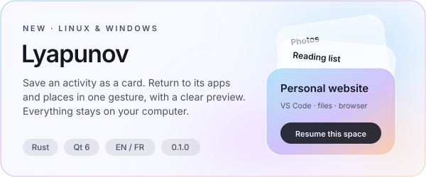

  <picture>
    <source media="(prefers-color-scheme: dark)" srcset="assets/banner-dark.svg">
    
  </picture>

  I build desktop tools that feel native and stay out of the way, 
  and small utilities for authorized security testing. 
  Everything runs locally: no accounts, no telemetry.

  <a href="https://tool.chaostic.cloud"><strong>Explore the live Chaos-Tic showcase →</strong></a>

 

  <a href="https://github.com/Chaos-Tic/Lyapunov/releases/tag/v0.2.0"><picture>
    <source media="(prefers-color-scheme: dark)" srcset="assets/card-lyapunov-dark.svg">
    
  </picture></a>

Latest: <a href="https://github.com/Chaos-Tic/Lyapunov/releases/tag/v0.2.0">Lyapunov 0.2.0</a> and <a href="https://github.com/Chaos-Tic/Lorenz/releases/tag/v1.2.1">Lorenz 1.2.1</a> for Linux and Windows.

  <a href="https://github.com/Chaos-Tic/Lorenz"><picture>
    <source media="(prefers-color-scheme: dark)" srcset="assets/card-lorenz-dark.svg">
    
  </picture></a>
  <a href="https://github.com/Chaos-Tic/Chaostic-Tool"><picture>
    <source media="(prefers-color-scheme: dark)" srcset="assets/card-chaostic-dark.svg">
    
  </picture></a>

### Toolbox

<picture>
  <source media="(prefers-color-scheme: dark)" srcset="assets/stack-dark.svg">
  
</picture>

 

Security work shown here is for systems I am authorized to test.

