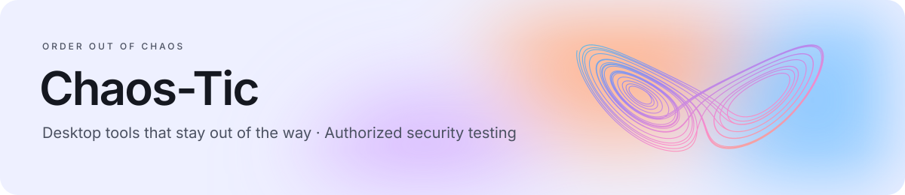
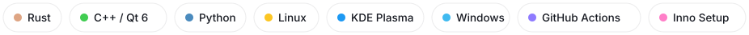

  <picture>
    <source media="(prefers-color-scheme: dark)" srcset="assets/banner-dark.svg">
    
  </picture>

  I build desktop tools that feel native and stay out of the way, 
  and small utilities for authorized security testing. 
  Everything runs locally: no accounts, no telemetry.

 

  <a href="https://github.com/Chaos-Tic/Lorenz"><picture>
    <source media="(prefers-color-scheme: dark)" srcset="assets/card-lorenz-dark.svg">
    
  </picture></a>
  <a href="https://github.com/Chaos-Tic/Chaostic-Tool"><picture>
    <source media="(prefers-color-scheme: dark)" srcset="assets/card-chaostic-dark.svg">
    
  </picture></a>

### Now building

**Lorenz 0.2**: a frosted-glass wheel that magnifies the choice under your pointer, in
English and French. [See it](https://github.com/Chaos-Tic/Lorenz#three-wheels)

  <a href="https://github.com/Chaos-Tic/Lorenz"><picture>
    <source media="(prefers-color-scheme: dark)" srcset="https://raw.githubusercontent.com/Chaos-Tic/Lorenz/main/docs/media/three-wheels-dark.png">
    
  </picture></a>

### Toolbox

<picture>
  <source media="(prefers-color-scheme: dark)" srcset="assets/stack-dark.svg">
  
</picture>

 

Security work shown here is for systems I am authorized to test.

